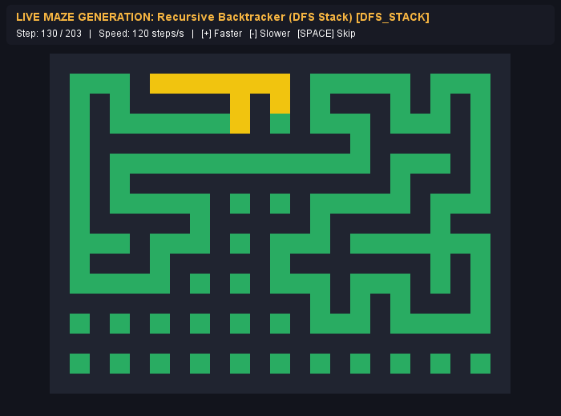
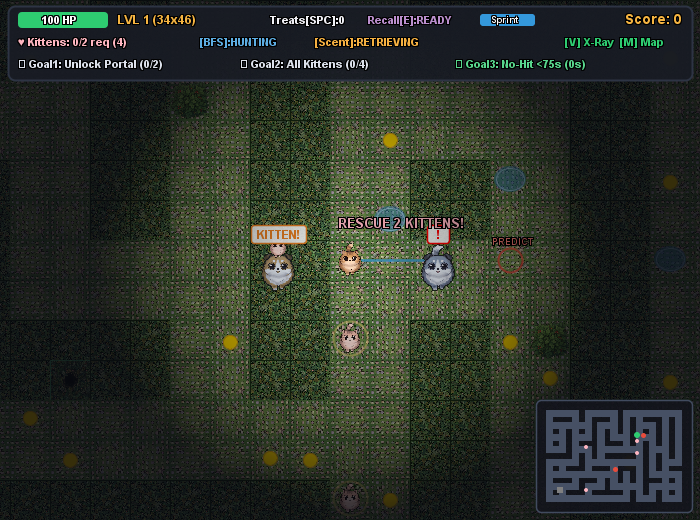

# Procedural Maze Evasion Game: Cat & Dog Edition (ADS Project)

A 2D procedural maze survival and evasion game built in pure **Java (Swing & AWT)** as an **Advanced Data Structures (ADS)** mini-project. It pairs hand-drawn storybook visuals and fast arcade evasion with live, inspectable implementations of Graph Theory, Minimum Spanning Trees, Shortest-Path Search, Stacks, Queues, Bounded Deques, Heaps, Spatial Hashing, and Finite State Machines.

---

## Screenshots

| Main Menu | Live Maze Generation (`GENERATING` Phase) |
| :---: | :---: |
|  |  |

| Gameplay (`2x2` Corridors, Multi-Color Dogs & Kittens) | Live ADS X-Ray Overlay (`[V]`) |
| :---: | :---: |
|  |  |

---

## How to Pull from Git & Run on PC

### Prerequisites
* **Java Development Kit (JDK) 17 or higher** (`javac` and `java` available on `PATH`)
* **Git**

### 1. Clone or Pull from GitHub
```bash
git clone https://github.com/ABHIisNotdead/Procedural-Maze-Evasion-Game.git
cd Procedural-Maze-Evasion-Game
```
To pull the latest updates on a specific branch:
```bash
git fetch origin
git checkout feature/ads-swarm-redesign
git pull origin feature/ads-swarm-redesign
```

### 2. Compile & Launch the Game
**Windows (PowerShell / CMD):**
```powershell
mkdir out\production\Procedural-Maze-Evasion-Game -Force
javac -encoding UTF-8 -d out/production/Procedural-Maze-Evasion-Game src/maze/*.java src/logic/*.java src/ui/*.java src/*.java
java -cp out/production/Procedural-Maze-Evasion-Game Main
```

**macOS / Linux:**
```bash
mkdir -p out/production/Procedural-Maze-Evasion-Game
javac -encoding UTF-8 -d out/production/Procedural-Maze-Evasion-Game src/maze/*.java src/logic/*.java src/ui/*.java src/*.java
java -cp out/production/Procedural-Maze-Evasion-Game Main
```

### 3. Run the Automated ADS Verification Suite
```bash
javac -encoding UTF-8 -cp out/production/Procedural-Maze-Evasion-Game -d out/production/Procedural-Maze-Evasion-Game src/test/*.java
java -cp out/production/Procedural-Maze-Evasion-Game test.MazeTestRunner
```

---

## Controls & How to Play

| Key | Action | Details |
| :--- | :--- | :--- |
| **`W A S D`** / **`Arrow Keys`** | Move Cat | Smooth pixel movement with corner-assist turning and wall-sliding |
| **`SHIFT`** (Hold) | Sprint | Speed burst while moving; consumes and regenerates Cat stamina |
| **`Q`** | **Hide (Invisible)** | Press on or next to a **Bush** or **Cracked Wall** to become invisible to all dogs; move or press `Q` again to exit |
| **`SPACE`** | Drop Fish Treat / Skip Gen | Drops a collected Fish Treat to lure & stun dogs (`3.5s`); during maze generation, skips straight to play |
| **`E`** | **Yarn Recall** | LIFO Stack ability: rewinds the Cat back along its recent path (`6s` cooldown) |
| **`V`** | **ADS X-Ray Visualizer** | Toggles live overlay of BFS/A* paths, Scent Deque nodes, Yarn Stack, and `PREDICT` target |
| **`M`** | Minimap | Toggles the corner radar minimap |
| **`+` / `-`** | Generation Speed | Speeds up or slows down the live maze generation animation |
| **`P` / `ESC`** | Pause / Menu | Freezes the pause-safe simulation clock; `ESC` on end screens returns to menu |
| **`R`** | Restart Level | Resets the current level with the same seed |
| **`N`** | Next Level | Advances to the next campaign level when cleared |

---

## Game Loop & Every Feature Explained

### 1. Fixed-Timestep, Pause-Safe Game Loop (`GameWindow.java`)
* **60 Hz Fixed-Timestep Accumulator (`FIXED_DT = 1/60s`):** Physics, stamina, scent decay, and AI movement run at a deterministic 60 updates per second regardless of monitor refresh rate.
* **Pause-Safe Game Clock (`gameTimeMs`):** Buffs (`Catnip`), stuns, `Yarn Recall` cooldowns, and `DistractionItem` timers all read `gameTimeMs` instead of wall-clock `System.currentTimeMillis()`, so pausing freezes every timer cleanly.

### 2. Four-Phase Level Progression
1. **`GENERATING` (Optional Live Visualizer):** Watch the selected ADS algorithm carve the maze step-by-step with adjustable speed (`10–400 steps/s`) or `[SPACE]` to skip.
2. **`RESCUE` (Portal Locked):** Stray Kittens spawn across the maze. Dogs also roam and try to `RETRIEVE` kittens back to their kennel (respawning them elsewhere if delivered, never soft-locking the level). Collect Fish Treats and rescue the required number of kittens to awaken the Exit Portal.
3. **`ESCAPE` (Portal Awakened):** Once the kitten quota is met, the glowing Exit Portal unlocks and the Dog Swarm enters heightened alert/speed until you extract.
4. **`CLEARED` / `DEFEATED`:** Displays your 1–3 Star rating, campaign score, time, and AI node telemetry. Advancing (`[N]`) carries over your **Campaign Score**, collected **Fish Treats**, and restores **+25 HP**.

### 3. Three-Star Level Goals & Objective Compass
* **Goal 1 (★):** Rescue the required kittens and escape through the unlocked Exit Portal.
* **Goal 2 (★★):** Rescue **all** stray kittens on the map (`+200` bonus).
* **Goal 3 (★★★):** Clear the level with **0 damage taken** under `75s` (`+200` bonus).
* **Objective Compass:** A directional arrow orbits the Cat pointing toward the nearest kitten during `RESCUE`, and toward the Exit Portal during `ESCAPE`.

### 4. Interactive Terrain & Hiding Mechanics
* **Leafy Bushes (`bush.png`) & Biome Cracked Walls (`*_cracked_wall.png`):** Stand on or next to either hiding spot and press **`Q`** to tuck inside (`INVISIBLE [Q]`). While hidden, the Cat is rendered ghosted, nearby scent footprints are cleared, Swarm Comms lock is broken, and all dogs ignore and cannot damage you.
* **Water Puddles:** Sparse weighted terrain (`weight = 2` / `3` for A*) that slows movement slightly unless boosted by Catnip.
* **Cat Flaps (`CAT`):** Narrow wall shortcuts that only the Cat can pass through, forcing Dogs to route around loops.
* **Collectibles:**
  * **Coins (`+10`):** Scattered along corridors.
  * **Fish Treats (`+25`):** Player starts with **0** treats and must pick them up in the maze before dropping them with `SPACE` to lure and stun dogs for `3.5s`.
  * **Catnip (`+50`):** Grants `4.5s` of zoomies speed and lets you bonk/stun dogs on contact to knock stolen kittens loose.

### 5. Difficulty Modes, Map Sizes & Biomes
* **4 Difficulty Modes (`GameSettings.DifficultyMode`):**
  * **Easy:** Cat speed `4`, Dog speed `3`, `180 ms` step delay, `-2` detection radius
  * **Medium (Default):** Cat speed `4`, Dog speed `4`, `110 ms` step delay
  * **Hard:** Cat speed `4`, Dog speed `5`, `55 ms` step delay, `+3` detection radius
  * **Custom:** Independent sliders in Settings for **Cat Speed (`2–8`)** and **Dog Speed (`2–8`)**
* **Map Size Modes (`MapSizePreset`) & `2x2` Corridors:**
  * **Progressive (Auto-Grow):** Scales from `34x46` (Level 1) up to `66x94` (Level 5) and `78x110` (Endless).
  * **Fixed Presets:** `Compact (26x38)`, `Standard (34x46)`, `Big (46x62)`, `Massive (58x82)`.
  * **`2x2` Corridor Scaling:** Expands every corridor to 2 tiles wide (`80 px`) so the Cat and multi-chaser swarm can flank and maneuver without 1-tile bottlenecks.
* **4 Illustrated Biomes:** `GARDEN`, `DUNGEON`, `TEMPLE`, and `CYBER`, each with custom wall/path/cracked-wall art, deterministic random tile rotations (`0°/90°/180°/270°`), and a continuously rotating Exit Portal.

---

## Advanced Data Structures (ADS) Architecture

| ADS Topic / Structure | Where Implemented | Time / Space | Role in Game |
| :--- | :--- | :--- | :--- |
| **Sparse Adjacency List** | `MazeGraph.adjacencyList` | $O(V + E)$ space | Stores graph vertex/edge connectivity and random edge weights |
| **Disjoint-Set (Union-Find)** | `MazeGraph.DisjointSet` | $O(\alpha(V))$ per op | Path Compression + Union by Rank for **Kruskal's MST** |
| **Min-Heap (`PriorityQueue`)** | `MazeGraph.generatePrim`, `ChaserAI.findPathAStar` | $O(E \log V)$ | Pops minimum-weight frontier edge in Prim's MST and lowest $f(n)$ node in A\* |
| **Explicit Stack (`ArrayDeque`)** | `MazeGraph.generateDFS`, `GameWindow.yarnStack` | $O(1)$ push/pop | LIFO backtracking in DFS maze carving and **`[E]` Yarn Recall** |
| **Ordinary Queue (`ArrayDeque`)** | `ChaserAI.findPathBFS`, `MazeGraph.computeBFSDistances` | $O(V + E)$ | Unweighted shortest-path routing for **Vidhita's BFS Tracker** & spawn solver |
| **Bounded Deque / Circular Queue** | `ScentTrail` | $O(1)$ amortized | Sliding-window footprint trail with monotonic timestamps for the **Greedy Scent Hound** |
| **Greedy Optimization** | `ChaserAI` (`SCENT_HOUND`) | $O(1)$ per step | Selects freshest forward scent neighbor while consuming visited tiles to prevent oscillation |
| **Finite State Machine (FSM)** | `ChaserState`, `ChaserEntity`, `ChaserAI` | $O(1)$ transitions | Switches dogs between `PATROLLING`, `HUNTING`, `RETRIEVING`, and `STUNNED` |
| **Spatial Hash (`HashSet`)** | `ChaserAI.updateSwarm` (`reservedTiles`) | $O(1)$ lookup | Prevents multi-chaser stacking by reserving current and target grid tiles |
| **Max-Heap (`PriorityQueue`)** | `RunHistory.loadTopRuns` | $O(N \log N)$ | Ranks top-10 highest-scoring runs on the leaderboard |

### Multi-Chaser Swarm, Communication & Prediction (`ChaserAI.java`)
* **Dog 1 — Vidhita's BFS Tracker (Slate-Blue Husky):** Computes the unweighted shortest path via Ordinary Queue BFS.
* **Dog 2 — Greedy Scent Hound (Golden Amber):** Follows monotonically fresher timestamps in `ScentTrail`, consumes visited tiles to eliminate 2–3 tile loops, and flanks when alerted.
* **Dog 3 — A\* Weighted Tactician (Crimson-Russet, Level 3+):** Uses Min-Heap A\* with terrain weights (`Puddle = 3`, `Normal = 1`) to intercept the Cat's predicted path.
* **Swarm Blackboard Communication & Velocity Prediction:** When any dog detects the Cat, it broadcasts a `4.5s` Swarm Alert (`sharedAlertX, sharedAlertY`) and `predictPlayerLocation(...)` projects up to 4 open tiles ahead along the Cat's movement vector so interceptors cut off escape routes.

---

## How Each Map Generation Algorithm Works (`MazeGraph.java`)

1. **Kruskal's MST (`KRUSKAL_MST`):** Builds all internal edges between grid cells with random weights, sorts them, and iterates in ascending order—carving a wall whenever `DisjointSet.union(u, v)` connects two previously disjoint trees.
2. **Prim's MST (`PRIMS_MST`):** Starts from a random cell and pushes its frontier walls into a **Min-Heap (`PriorityQueue<Edge>`)**. Repeatedly pops the minimum-weight edge leading to an unvisited cell and grows the spanning tree outward.
3. **Recursive Backtracker (`DFS_BACKTRACKER`):** Uses an explicit **Stack (`ArrayDeque<Integer>`)** to walk randomly into unvisited neighbors, carving deep winding corridors and popping back when hitting a dead end.
4. **Cellular Automata (`CAVERN_CELLULAR`):** Seeds a connected Kruskal base, randomly opens 35% of internal walls, and applies a 4–5 neighbor smoothing rule to create organic cave chambers.
5. **Braid Loop Injector & `2x2` Scaling:** After the spanning tree is built, `applyBraiding()` removes dead ends and injects cycles (`braidChance`), guaranteeing **multiple valid paths** to the goal. Finally, every base cell and wall expands into a `2x2` tile block for wide, tactical corridors.
