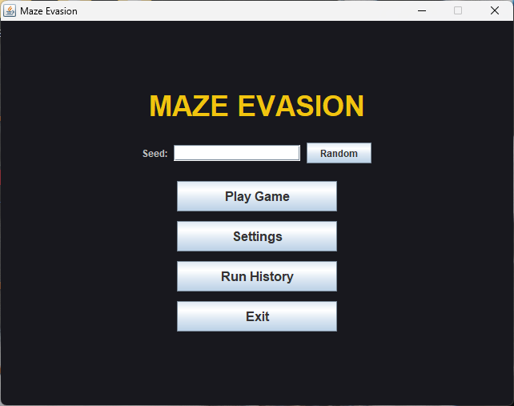
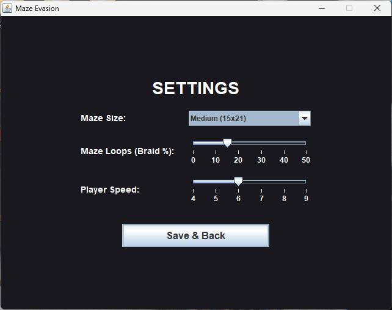
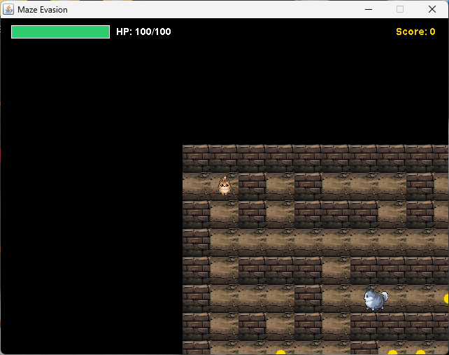
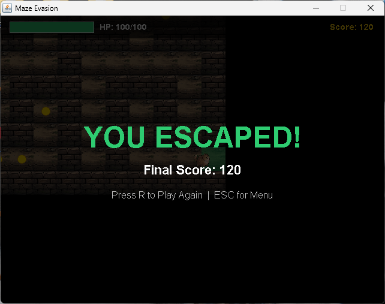
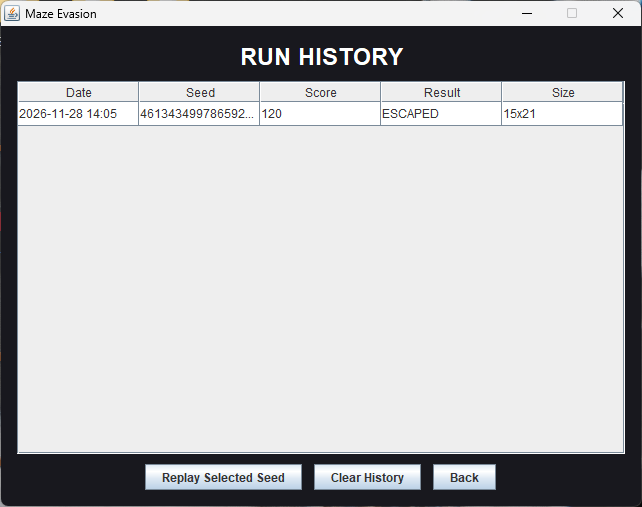

# Procedural Maze Evasion Game (Java)

A 2D arcade maze-survival game built in pure Java (Swing + Java2D) for our **ADS (Advanced Data Structures & Algorithms)** project. Navigate procedurally generated, seeded mazes, collect coins, and outmaneuver an intelligent Chaser enemy to reach the exit.

Includes a standalone Windows executable (`MazeEvasion.exe`) at the repository root.

---

## Screenshots

| Main Menu | Settings |
| :---: | :---: |
|  |  |

| Gameplay | Victory Screen |
| :---: | :---: |
|  |  |

| Run History |
| :---: |
|  |

---

## How the Game Works

1. **Seeded Maze Generation:** Enter a custom numeric seed or click **Random** to generate a deterministic maze layout. Replaying the same seed with the same settings produces the exact same maze and coin placement.
2. **Player Movement & Controls:** Move with `W`, `A`, `S`, `D` through corridors with smooth corner-sliding collision and a smoothly interpolating camera.
3. **Coins & Exit:** Collect gold coins (`+10` points each, placed on ~20% of open tiles) and reach the highlighted green exit on the right edge of the maze to win (`YOU ESCAPED!`).
4. **Chaser Enemy & Health:** An animated enemy patrols the maze and switches to shortest-path pursuit when you enter its detection radius. Each collision deals `25` damage with `1500 ms` of invincibility frames (`100` max HP). Reaching `0` HP triggers `GAME OVER`.
5. **Run History:** Every completed or failed run is logged to `run_history.csv` with timestamp, seed, score, result, and maze dimensions, and can be replayed directly from the **Run History** table.

---

## ADS Topics, Techniques & Methods Used

### 1. Graph Representation (`src/maze/MazeGraph.java`)
- **2D Grid Matrix (`int[][] grid`):** Stores the playable tile map where `WALL = 1` and `PATH = 0`. Odd dimensions (`rows × cols`, default `15 × 21`) map logical graph vertices `(cr, cc)` to grid coordinates `(2*cr + 1, 2*cc + 1)`, with walls occupying the even indices between them.
- **Adjacency Matrix (`int[][] adjacencyMatrix`):** A `totalCells × totalCells` matrix (`cellRows * cellCols` vertices) updated symmetrically (`adjacencyMatrix[u][v] = 1`, `adjacencyMatrix[v][u] = 1`) whenever `carve(Edge)` opens a passage between two cells.

### 2. Disjoint-Set Union / Union-Find (`MazeGraph.DisjointSet`)
- **Data Structure:** Maintains `parent[]` and `rank[]` arrays for all `totalCells` vertices.
- **Methods:**
  - `find(int i)`: Uses **Path Compression** (`parent[i] = find(parent[i])`) to flatten tree depth during lookups.
  - `union(int i, int j)`: Uses **Union by Rank** to attach the shallower tree under the deeper tree, returning `false` if `u` and `v` are already in the same connected component (cycle detection).
- **Complexity:** $O(\alpha(V))$ amortized per operation, where $\alpha$ is the inverse Ackermann function.

### 3. Randomized Kruskal's Algorithm & Fisher-Yates Shuffle (`MazeGraph.generate()`)
- **Edge Construction:** Builds all horizontal and vertical `Edge(u, v, wallRow, wallCol)` candidates connecting adjacent grid cells.
- **Deterministic Fisher-Yates Shuffle:** Shuffles `edges` in-place using a single seeded `Random(seed)` instance, guaranteeing identical maze generation across different machines and Java versions.
- **Spanning Tree Construction (Step 1):** Iterates through the shuffled edges and calls `ds.union(edge.u, edge.v)` until `totalCells - 1` walls are carved, producing a **Minimum Spanning Tree** (a perfect maze with exactly one path between any two cells).
- **Maze Braiding / Loop Injection (Step 2):** Iterates over remaining uncarved edges and opens walls with probability `braidChance` (default `0.15`, configurable `0%–50%` in Settings). Adding cycles gives the player multiple evasion routes so the Chaser cannot trap them in a single dead-end corridor.
- **Complexity:** $O(V + E \cdot \alpha(V))$ time and $O(V^2)$ space (due to the adjacency matrix).

### 4. Breadth-First Search (BFS) Shortest-Path AI (`src/logic/ChaserAI.java`)
- **Detection Radius (`detectionRadius = 5`):** Computes Manhattan distance $|x_1 - x_2| + |y_1 - y_2|$ between the Chaser's grid cell and the player's grid cell.
- **BFS Traversal (`findNextMove`):**
  - Uses a FIFO `Queue<int[]>` (`java.util.LinkedList`), a `boolean[][] visited` matrix, and `int[][] parentX`, `int[][] parentY` predecessor arrays.
  - Explores 4-directional neighbors (`DIRECTIONS`: Up, Down, Left, Right) level by level via `isOpen(maze, nx, ny)` until the player's cell is reached.
  - **Path Reconstruction:** Backtracks from `(targetX, targetY)` through `parentX`/`parentY` until reaching the immediate neighbor of `(startX, startY)`, returning the next single tile step.
- **Patrol & Anti-Backtracking Heuristic:** When the player is outside `detectionRadius` (or unreachable), `nextMove()` collects all open adjacent cells, removes `(previousX, previousY)` if more than one move is available (preventing back-and-forth oscillation), and picks a random direction.
- **Complexity:** $O(R \times C)$ time and $O(R \times C)$ space per BFS query on an $R \times C$ grid.

---

## Engine, UI & Packaging Architecture

- **Navigation (`src/ui/MainFrame.java`):** Uses `CardLayout` to switch cleanly between `MENU`, `SETTINGS`, `HISTORY`, and active `GameWindow` panels.
- **Game Loop & Rendering (`src/ui/GameWindow.java`):**
  - Runs at ~60 FPS using `javax.swing.Timer(16, this)`.
  - Uses Swing **Key Bindings** (`InputMap` / `ActionMap`) for `W`, `A`, `S`, `D`, `R` (restart), and `ESC` (return to menu).
  - Implements pixel-stepped movement (`movePlayer`) with corner-sliding around wall edges (`canMove`, `isWall`) and exponential camera smoothing (`camX += (targetCamX - camX) * 0.15`).
  - Slices 4×4 sprite sheets via `BufferedImage.getSubimage` (`assets/player_sheet.png` at `512×512` per frame; `assets/enemy_sheet.png` at `256×256` per frame) and loads images from the JAR classpath (`/assets/...`) with a `File` fallback.
- **Settings & Persistence (`src/logic/GameSettings.java`, `src/logic/RunHistory.java`):**
  - Supports Small (`11×15`), Medium (`15×21`), and Large (`21×31`) mazes, Braid % (`0–50`), and Player Speed (`4–9`).
  - Persists run records to `run_history.csv` and populates a `JTable` with one-click seed replay.
- **Standalone Windows Executable (`MazeEvasion.exe`):**
  - Embeds the compiled JAR (classes + `assets/`) inside a native Windows GUI launcher compiled with `csc.exe`, requiring no external folders or DLLs (only Java 8+ installed on the machine).

---

## Project Structure

```text
├── MazeEvasion.exe              # Standalone Windows executable
├── assets/
│   ├── enemy_sheet.png          # 4x4 animated enemy sprite sheet (256x256/frame)
│   ├── player_sheet.png         # 4x4 animated player sprite sheet (512x512/frame)
│   ├── path.png                 # Floor tile sprite
│   └── wall.png                 # Wall tile sprite
├── docs/screenshots/            # README screenshots
└── src/
    ├── Main.java                # Entry point (launches MainFrame on EDT)
    ├── logic/
    │   ├── ChaserAI.java        # BFS shortest-path & patrol AI
    │   ├── GameSettings.java    # Configurable maze size, braid %, speed
    │   └── RunHistory.java      # CSV run logging & loading
    ├── maze/
    │   └── MazeGraph.java       # Kruskal's MST + DisjointSet + Braiding
    └── ui/
        ├── GameWindow.java      # Game loop, physics, sprites, HUD, overlays
        └── MainFrame.java       # Menu, Settings, and Run History UI
```

---

## How to Run

### Option 1: Windows Executable
Double-click `MazeEvasion.exe` directly (requires Java 8 or newer installed).

### Option 2: Compile & Run from Source
```bash
javac -d out src/Main.java src/logic/*.java src/maze/*.java src/ui/*.java
java -cp out Main
```
